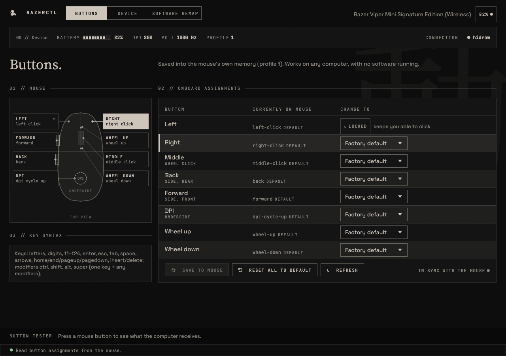

# razerctl

> razerctl is an independent, community project. It is **not affiliated with, authorized, sponsored or endorsed by Razer Inc.**
> "Razer", "Synapse", "Viper" and related names and marks are trademarks of Razer Inc. and are used here only to describe
> which hardware and protocol this tool is compatible with.



## Install

Pick one format. Every one needs the [udev rule](#the-udev-rule) once, because only root can install it.

Prebuilt downloads are on the [releases page](https://github.com/Dromares/razerctl/releases/latest); building from source is optional.

### AppImage

Download `razerctl-X.Y.Z-x86_64.AppImage` from the [latest release](https://github.com/Dromares/razerctl/releases/latest), then:

```
chmod +x razerctl-X.Y.Z-x86_64.AppImage && ./razerctl-X.Y.Z-x86_64.AppImage
sudo curl -fLo /etc/udev/rules.d/70-razerctl.rules https://github.com/Dromares/razerctl/releases/latest/download/70-razerctl.rules && sudo udevadm control --reload && sudo udevadm trigger
```

The second line is the udev rule (see below); an AppImage cannot install it by itself. It needs glibc 2.35 or newer and
carries the GUI and CLI binaries and no systemd units: the app writes its own when you turn on the remap service or the
low-battery notifier. Details and the build recipe are under
[AppImage details](#appimage-details-and-building).

### Tarball

Download `razerctl-X.Y.Z-x86_64-linux.tar.gz` from the same release page (it needs glibc 2.35 or newer, plus the
Wayland/X11, xkbcommon, OpenGL and libnotify libraries from your distro):

```
tar xzf razerctl-X.Y.Z-x86_64-linux.tar.gz && cd razerctl-X.Y.Z-x86_64-linux
sudo install -Dm755 razerctl razerctl-gui -t /usr/local/bin
sudo install -Dm644 70-razerctl.rules /etc/udev/rules.d/70-razerctl.rules
sudo install -Dm644 razerctl.desktop -t /usr/local/share/applications
sudo install -Dm644 razerctl.svg -t /usr/local/share/icons/hicolor/scalable/apps
sudo install -Dm644 icons/razerctl-*symbolic.svg -t /usr/local/share/icons/hicolor/symbolic/apps
sudo udevadm control --reload && sudo udevadm trigger
```

The optional remap and low-battery services are in `systemd/`; they point at `~/.local/bin`, so copy them into
`~/.config/systemd/user/` after changing that path to `/usr/local/bin`.

### From source

```
./install.sh                 # builds, installs CLI + GUI + app-menu entry to ~/.local, udev rule via sudo
./install.sh --uninstall
# or, as a local Arch/CachyOS package built from this checkout:
cd packaging && makepkg -si
```

### The udev rule

razerctl reads and writes the mouse through `hidraw` and `/dev/input`, which only root can open by default.
`udev/70-razerctl.rules` grants the logged-in user access to Razer (USB vendor `1532`) devices. Each format installs it
as shown above (`install.sh`, the `packaging/PKGBUILD` build and the tarball steps put it in place; the AppImage needs the one `sudo`
line). udev applies a rule when a device is plugged in, so after installing it **unplug and replug the mouse**; that
is the fallback that always works. `sudo udevadm control --reload && sudo udevadm trigger` should apply it without a
replug, but that has not been tested on every desktop, so replug if the GUI still reports no access.

### Updating

| Installed with | How it updates |
|---|---|
| Package (files under `/usr/`) | Through the package manager that installed it, with the rest of the system. For the local build from `packaging/PKGBUILD` (`makepkg -si`), rebuild and reinstall the package from a newer checkout. razerctl never replaces files under `/usr`. |
| AppImage | The in-app update check shows the new version and its changelog and only updates after you confirm. [AppImageUpdate](https://github.com/AppImageCommunity/AppImageUpdate), Gear Lever and AppImageLauncher also work, using the release's `.zsync` file. |
| Tarball / `install.sh` | The in-app check only tells you a newer release exists; repeat the install steps with the new tarball (for `install.sh`, `git pull` and run it again). |

Nothing updates silently. The in-app check can be turned off in the GUI settings.

### Integrity of downloads

Each release has a `SHA256SUMS` file; check a download with `sha256sum -c SHA256SUMS --ignore-missing`. The in-app
updater does the same before it replaces anything. This catches a corrupted or truncated download. It does **not**
protect against someone taking over the GitHub account or the release: the checksums come from the same place as the
files. Releases are not signed.

### What you get

Open **razerctl** from the app menu (or run `razerctl-gui`).

* **Buttons** tab: remaps saved *into the mouse* (onboard memory, profile 1). They keep working
  with no software running, on any computer. Left click is locked so you can't lose clicking.
* **Device** tab: battery, firmware, serial, DPI stages, set DPI / polling rate.
* **Software remap** tab: optional computer-side remapper (`remap.conf` + systemd user service)
  for things the mouse can't store. From the AppImage, Start / Enable at login need no install step either (see below).
* **Low-battery notification** (Device tab): optional desktop alert at or below a chosen
  percentage, run by the `razerctl-battery.service` user unit (settings in
  `~/.config/razerctl/battery.conf`). From the AppImage, turning it on needs no install step: the app writes the unit
  itself (see [AppImage details](#appimage-details-and-building)).
* **Button tester** (bottom bar): shows what the computer actually receives when you press a button.

CLI equivalent: `razerctl --backend hidraw onboard` / `onboard set BUTTON ACTION`.
Protocol details: [docs/onboard-button-protocol.md](docs/onboard-button-protocol.md).

### AppImage details and building

A release carries `razerctl-X.Y.Z-x86_64.AppImage`: the GUI as one file, built in an Ubuntu 22.04 root filesystem. It
**needs glibc 2.35 or newer** (the GUI binary's highest symbol is `GLIBC_2.35`): Ubuntu 22.04, Debian 12 and Fedora 36
or newer are fine; RHEL, Rocky and Alma 9 (glibc 2.34), Ubuntu 20.04 and Debian 11 refuse to start with
`GLIBC_2.35 not found`. It bundles no graphics libraries: Wayland, X11, xkbcommon and OpenGL come from the host. It
does **not** install the udev rule, so the mouse stays unreachable until you install it (see
[Install, AppImage](#appimage)).

The command-line tool is inside it too (`--appimage-extract`, then `squashfs-root/usr/bin/razerctl`). The
systemd units are not packaged; the app writes the two it needs into `$XDG_CONFIG_HOME/systemd/user/` (normally
`~/.config/systemd/user/`) when you ask for them, with `ExecStart=` running the AppImage file itself (`$APPIMAGE`, never
the temporary mount path):

* **Low-battery notifier**: turning it on in the Device tab writes `razerctl-battery.service` running
  `<the AppImage> battery-watch`, reloads systemd and enables it.
* **Remap service**: Start, Save and restart, and Enable at login in the Software remap tab (and Start in the tray menu)
  write `razerctl-remap.service` running `<the AppImage> remap`, with the same restart policy as `systemd/razerctl-remap.service`
  (a config problem exits 78 and is not retried). Disable at login stops it and deletes the file. It needs read access to the
  mouse's `/dev/input/event*` nodes, which the udev rule from [Install, AppImage](#appimage) grants, and `/dev/uinput`.

Moving the AppImage and starting it (or pressing Start / turning the notifier on again) rewrites the path in a unit the app
wrote, and turning a service off deletes its file. A unit that `./install.sh` or a package put there is never overwritten.
`<the AppImage> remap` and `<the AppImage> macros …` do what `razerctl remap` and `razerctl macros …` do.

To build one (the image needs at least the build machine's glibc, so the release is built
in an Ubuntu 22.04 root filesystem):

```
cargo install cargo-packager --locked --version 0.11.8
cargo build --release --locked
cargo run --release --locked --example fetch_appimage_tools -- cargo packager --release --formats appimage
```

The packaging settings are in `Cargo.toml` under `[package.metadata.packager]`; the output is
`target/packager/razerctl-gui_<version>_x86_64.AppImage`, renamed to `razerctl-<version>-x86_64.AppImage` for the release.
It needs `patchelf`, `file`, `desktop-file-utils` and `squashfs-tools` installed.

`fetch_appimage_tools` also sets `LDAI_UPDATE_INFORMATION` (`tools::UPDATE_INFO`), so the image embeds `gh-releases-zsync|Dromares|razerctl|latest|razerctl-*-x86_64.AppImage.zsync` and tools such as AppImageUpdate can delta-update it from the newest release. To read it back, `./razerctl-X.Y.Z-x86_64.AppImage --appimage-updateinformation` works when the image mounts normally (the AppImage runtime answers it); with `APPIMAGE_EXTRACT_AND_RUN=1`, or on a machine without FUSE, the runtime does not and the flag reaches the app, so read the `.upd_info` section instead: `objcopy -O binary --only-section=.upd_info razerctl-X.Y.Z-x86_64.AppImage /dev/stdout | tr -d '\0'` (`binutils`). `--version` and `--help` always work, with either start mode and with no display. appimagetool then runs `zsyncmake` (the `zsync` package) and leaves a `.zsync` under `target/packager/.cargo-packager/appimage/`, but that file names the packager's `razerctl-gui_<version>_x86_64.AppImage`, so the release job runs `zsyncmake` again on the renamed copy.

#### Release assets

Pushing a tag `vX.Y.Z` runs `.github/workflows/release.yml`, which refuses a tag that is not `v` plus the `Cargo.toml` version or has no `## vX.Y.Z` section in `CHANGELOG.md` (`examples/release_notes` prints that section as the release notes), builds and tests, and creates a **draft** release with these assets; a person publishes the draft:

- `razerctl-X.Y.Z-x86_64.AppImage` and `razerctl-X.Y.Z-x86_64.AppImage.zsync`
- `razerctl-X.Y.Z-x86_64-linux.tar.gz`: one directory `razerctl-X.Y.Z-x86_64-linux/` with `razerctl`, `razerctl-gui`, `70-razerctl.rules`, `razerctl.desktop`, `razerctl.svg`, `razerctl.png`, `icons/` (the symbolic tray icons), `systemd/` (the two user units, unmodified: `ExecStart=%h/.local/bin/razerctl`), `LICENSE` and `README.md`
- `70-razerctl.rules`, the same file as `udev/70-razerctl.rules`
- `SHA256SUMS`, `sha256sum -c` format, one line for each of the four assets above

A tag with a `-` in it (`v0.2.90-test.1`) is created as a pre-release. The workflow has not run on hosted runners yet; the steps were run by hand in an Ubuntu 22.04 root filesystem (DAN-1668).

The image contains four third-party binaries that `cargo-packager` would otherwise fetch from moving release tags at build
time, unverified. `examples/fetch_appimage_tools` (Rust, like `gen_icons`) downloads them with `curl`, checks them against the sha256 values below, and aborts
on a mismatch before anything is built (`LDAI_RUNTIME_FILE` makes the plugin use the checked runtime instead of downloading one):

| File | Source | sha256 |
|---|---|---|
| `AppRun-x86_64` | tauri-apps/binary-releases `apprun-old` | `f30140a43a0a59e46db21bdefdf749b9e9f2c6946e92afabbacf98b8ae73fb4f` |
| `linuxdeploy-x86_64.AppImage` | tauri-apps/binary-releases `linuxdeploy` | `e762bea85c8eb0d4b3508d46e5c1f037f717d0f9303ae3b4aafc8b04991fa1ef` |
| `linuxdeploy-plugin-appimage-x86_64.AppImage` | linuxdeploy/linuxdeploy-plugin-appimage `continuous` | `49d6a17160675a6bd1781699aae6bdf7692d98552e02a3671d2183d10547842e` |
| `runtime-x86_64` | AppImage/type2-runtime `continuous` | `156f4bdbde9c52d01814600013e0a273f0118dc2de98975f3c8c63427ec79074` |

The upstream tags can move; when one does the tool fails closed, and the pin is bumped deliberately (edit `examples/fetch_appimage_tools/tools.rs` and this table; `tests/appimage_tools.rs` fails if they differ).

---

A Linux rewrite, in Rust, of the device-control core of **Razer Synapse 4 for macOS**
(`RazerSynapseInstaller.pkg`, RazerAppEngine 4.4.25).

## Verifying a change (local CI)

Hosted Actions are not available, so a non-author verifies a PR by running one command at the PR head SHA in a clean worktree:

```sh
scripts/local-ci.sh /path/to/verify.log
```

It prints the toolchain (`rustc -V`, `cargo -V`, pinned by `rust-toolchain.toml`), checks the GUI system libraries with `pkg-config`, then runs `cargo build --release --locked`, `cargo test --release --locked`, `cargo clippy --all-targets`, `cargo fmt --check`, and an `xvfb-run` smoke test that launches `razerctl-gui` for 5 s with an isolated `HOME` (no device writes). Clippy is compared with a baseline recorded in the script (`CLIPPY_BASELINE`): a new warning fails; existing debt is reported. `cargo fmt --check` is strict: any unformatted hunk fails. Exit status is 0 only on `RESULT: PASS`; attach the log to the PR.

## What was in the .pkg

| Component | What it is | Rewritten? |
|---|---|---|
| `Razer.app/Contents/Resources/app.asar` | Electron shell (main process + IPC bridge). The UI itself is a remote web app loaded from `app-assets.razer.com` | **Device I/O path yes**; UI no (it's Razer's hosted, proprietary web app) |
| `electron/Protocol/protocol25*.js`, `UsbRzDeviceAction.js` | Protocol25 framing, status codes, `hid.sendFeatureReport`/`getFeatureReport` IPC | **Yes** → `src/protocol.rs`, `src/hidraw.rs` |
| `node-rz-hid`, `rz-usb-detect` (IOKit .node addons) | HID transport and hot-plug | **Yes** → `/sys/class/hidraw` + `HIDIOC[SG]FEATURE` |
| `com.razer.appengine.driver.dext` (DriverKit, arm64) | `RazerGenericHIDDriverKit`: intercepts input reports so buttons can be remapped/hooked (`SetHook`, `HandleMouseButton`, `handleReport`) | **Yes** → `src/remap.rs` (evdev grab + uinput) |
| Per-device Synapse middleware (`apps.razer.com/synapse/products/158/mw/`, not in the .pkg) | Onboard-memory button assignment (`setSingleButtonAssignment`, obmEngine) | **Yes** → `src/onboard.rs`, GUI Buttons tab |
| Synapse web UI | — | **Replaced** by `razerctl-gui` (egui/eframe) |
| `libmapping_engine.dylib`, `libsimple_service.dylib` | Macro/key-mapping engine, background services | No |
| `RazerGameManagerService` (.NET + SteamKit2) | Game library scanner for auto-profile switching | No |
| Sentry telemetry, Razer ID login, updater, installer scripts | — | Intentionally dropped |

## Protocol (Protocol25)

There are 90-byte feature reports, sent with report ID 0 (91 bytes on the wire):

```
[0] status  [1] transaction id  [2..3] remaining packets (BE)  [4] protocol type
[5] data size  [6] command class  [7] command id  [8..87] args  [88] XOR(2..87)  [89] 0
status: 0 new, 1 busy, 2 success, 3 failed, 4 timeout, 5 not supported
```

## Backends

* `openrazer-sysfs` (automatic when the `razermouse`/`razerkbd` kernel driver is bound). It
  uses the driver's sysfs attributes, so it never races the kernel for the control channel.
  The user needs to be in the `openrazer` group.
* `hidraw`: raw Protocol25. This needs rw access to `/dev/hidraw*`:
  `sudo cp udev/70-razerctl.rules /etc/udev/rules.d/ && sudo udevadm control --reload && sudo udevadm trigger`

## Usage

```
razerctl list | info | battery | dpi [X [Y]] | poll [HZ] | raw CLASS ID SIZE [ARGS..]
razerctl --backend hidraw raw 00 81 02      # firmware version, raw
```

## Firmware: inspect, dry-run and bootloader probe (flashing is not supported yet)

```
razerctl firmware inspect ViperMiniSignatureEdition_..._FirmwareUpdater_....exe
razerctl firmware flash   ViperMiniSignatureEdition_..._FirmwareUpdater_....exe --image Dev1 --dry-run
razerctl firmware probe-bootloader --yes-enter-bootloader
```

`inspect` reads Razer's firmware updater `.exe` that you downloaded yourself, finds the ZIP appended to it, and lists each
firmware image inside: the product id it is for, the version, the address range, the size and its SHA-256, after checking
every Intel-HEX record checksum. It refuses a damaged or unfamiliar file and says what is wrong. `flash ... --dry-run`
runs the vendor's flashing sequence against a *simulated* device and prints every frame it would send. Both are offline:
razerctl opens no device for either, and it does not ship or download Razer's firmware, so the image never leaves your copy
of the updater. **Flashing a real device is not supported yet**; without `--dry-run` the command refuses.

`probe-bootloader` is the one firmware command that talks to a device, and it only runs when you ask for it with `--yes-enter-bootloader`.
It is a measurement for a later update feature. It reads the Viper Mini SE's version (`00:87`) and puts it into its
bootloader (`00:04`, mode 1). It starts from the dongle (`1532:009F`), from the mouse on its USB cable
(`1532:009E`), or from a mouse that is already in its bootloader (`1532:110E`, see below); exactly one of them must be connected, and the report says which one it used. The bootloader enumerates as `1532:110E` (on the board's two probe v3 runs through the dongle it did
not; on the cable it did, 5.8 s after the send). What the kernel does with it depends on the device. The dongle's bootloader has no interrupt endpoint, so no driver binds it and the kernel makes **no hidraw node** for it; the mouse's bootloader (`bcdDevice 0x0200`) has one, `usbhid` binds it, and it **does** get a hidraw node. The
probe finds the bootloader in `/sys/bus/usb/devices` (reading sysfs sends nothing) and writes down the bus and device number,
`bcdDevice`, product string, any driver bound to interface 0, its hidraw node and the kernel's cached descriptors. It then opens
the bootloader (at least 1000 ms after it appears, the wait Razer's updater makes), reads its
HID report descriptor and sends the query frame `10:80` that Razer's updater sends first on every bootloader open. `10:80` asks
the bootloader for its PID and changes nothing. With no driver bound it opens the bootloader's `/dev/bus/usb/BBB/DDD` node and sends `10:80` and `10:05` as HID feature SET_REPORTs. With `usbhid` bound and exactly one hidraw node (found by following sysfs from the USB device to its `hidraw` child, not by the HID name) it sends the same two frames as HID feature reports on that node (`HIDIOCSFEATURE`, report id `0`, the same 90 bytes) and reads the answers with `HIDIOCGFEATURE`; it never detaches `usbhid`. Only if the reply has status 2 and a PID equal to the one it started from (`009F` for the dongle, `009E` for the cable) does the probe
send exit (`10:05`), straight away on the same handle; any other reply (or none) ends the run
there, nothing more is sent and it tells you how to get the mouse back (below). It then waits up to 30 s for the same `1532:009F` / `1532:009E` to come back, recording how
long that took from the `10:05` send and from entry (which tells whether `10:05` is what brought it back). Whether
`10:05` makes the bootloader exit is not known: on the first run it was accepted and the dongle stayed in the bootloader until it was replugged. An error on the enter send counts as
"entered" only if the device then leaves the USB bus. If `1532:110E` does not appear within 10 s, the report lists every `1532`
device the kernel shows at that moment (ID, port, `bcdDevice`, product), in case the bootloader enumerates under another ID. Everything goes into a text file (`--out FILE`, default
`razerctl-bootloader-probe-<time>.txt` in the current directory) that is meant to be pasted into the issue as it is. The report also holds the bootloader's HID report descriptor, the node it used, and all 90 bytes of every `10:80` and `10:05` reply.

### Running it on the cable

To try the mouse on its USB cable instead of through the dongle, unplug the dongle (or the cable) so that only one of
`1532:009F` and `1532:009E` is connected, then run the same command:

```
razerctl firmware probe-bootloader --yes-enter-bootloader --out cable-probe.txt
```

With both connected, or neither, it refuses and sends nothing. On the cable, a `10:80` reply that names any PID other than `009E`
sends no `10:05`. The udev rule is the same for both. **A replug of the USB cable does not reset the mouse**: it runs on its
battery, so unplugging the cable does not power it down, and a mouse left in its bootloader stays there (see *Getting the mouse back*).

### Starting from a mouse that is already in its bootloader

If a run left the mouse in its bootloader (`lsusb | grep -i 1532` shows `1532:110e`), connect only the mouse's cable (no dongle) and run the same command:

```
razerctl firmware probe-bootloader --yes-enter-bootloader --out bootloader-probe.txt
```

When the only Razer device on hidraw is exactly one `1532:110E` node, the probe skips the version read and the enter frame (nothing is sent to a normal-mode node), lets the bootloader settle for 1000 ms from the moment it found it, and goes straight to `10:80`. It sends `10:05` only if the reply has status 2 and a PID of `009E` or `009F`, and then waits for that same PID to come back. The report says "started from the bootloader". Any other mix (a `110E` together with `009F` or `009E`, or two `110E` nodes) is refused with nothing sent, naming what was found.

### Getting the mouse back

If the probe stops with the mouse in its bootloader (the report says so and the command prints these lines):

* **Dongle runs:** unplug the dongle and plug it back in. The dongle is bus-powered, so that resets it.
* **Cable and bootloader runs:** a cable replug does **not** work. Switch the mouse off with the switch on its underside, wait 10 s and switch it on (not verified). If it is still in its bootloader (`lsusb` shows `1532:110e`), use Razer's updater on Windows, or in a VM with the USB port passed through. Nothing was erased or written, so the firmware on the mouse is intact.

Before running it, reinstall the udev rule, which has a line for `1532:110E` (without it the dongle's bootloader node is
root-only and the probe stops before sending anything to it; the mouse's hidraw node is covered by the rule's first line):

```
sudo cp udev/70-razerctl.rules /etc/udev/rules.d/ && sudo udevadm control --reload && sudo udevadm trigger
```

* **It never erases or writes firmware.** Over the normal-mode hidraw node the command can send exactly two frames (`00:87` and `00:04`
  mode 1). To the bootloader it can send exactly two more (`10:80` and `10:05`), either as three usbfs control requests (the HID report descriptor read, a feature SET_REPORT that
  carries `10:80` or `10:05` byte for byte, and the GET_REPORT that reads its status; the only ioctls are `USBDEVFS_CONTROL` and
  `USBDEVFS_CLAIMINTERFACE`) or on the bootloader's hidraw node (five ioctls only: `HIDIOCGRAWINFO`, `HIDIOCGRDESCSIZE`, `HIDIOCGRDESC`, `HIDIOCSFEATURE` and `HIDIOCGFEATURE`, and no `write(2)`). No erase, program or Flash-stream frame exists in it, and `cargo test` fails if one is added.
* Without `--yes-enter-bootloader` it only prints what it would do and exits with an error; nothing is sent.
* If the bootloader's node cannot be opened (no udev rule), or a kernel driver other than `usbhid` owns interface 0, or `usbhid` owns it but it has no single hidraw node, it sends nothing to the
  bootloader, never uses root or detaches the driver, writes down the error number or the driver, and prints the lines of *Getting the mouse back*.
* It refuses to start while another razerctl (the remap or battery service, the GUI, another command) or openrazer
  (`openrazer-daemon`, or the `razermouse` kernel driver bound to the dongle) is using the device, or anything else has its
  hidraw node open. Stop them first.
* **The mouse does not work while it runs.** The worst case is that it sits in bootloader mode: a dongle recovers with a replug, the mouse on its cable does not (see *Getting the mouse back*). If a step times out the file says which one and the command prints the matching instructions. Whether `10:05` brings the mouse out of its bootloader has not
  been confirmed on Linux, which is part of what the probe is for. Razer's own updater on Windows is the
  fallback; that it can talk to a mouse already in bootloader mode is inferred from its code, not tested.

## Button remapping (replaces the DriverKit extension)

Synapse's `com.razer.appengine.driver.dext` intercepts button reports (`handleReport` →
`HandleMouseButton` → hooks set by `SetHook`) and lets the mapping engine substitute an action.
`razerctl remap` does the same in user space: it takes an exclusive EVIOCGRAB on the mouse's evdev
nodes, mirrors them onto a uinput device named "razerctl remapped mouse", and rewrites mapped buttons.

```
razerctl buttons                         # press buttons to see their names
razerctl remap --map back=ctrl+c         # quick test, Ctrl+C to stop
$EDITOR ~/.config/razerctl/remap.conf    # persistent rules
install -Dm755 target/release/razerctl ~/.local/bin/razerctl
cp systemd/razerctl-remap.service ~/.config/systemd/user/ && systemctl --user enable --now razerctl-remap
```
Requirements: read access to the Razer `/dev/input/event*` nodes (openrazer group) and rw on
`/dev/uinput` (your user already has both). From the AppImage there is no unit to copy: the Software remap tab writes it
when you press Start (see [AppImage details](#appimage-details-and-building)); the udev rule line from
[Install, AppImage](#appimage) is what grants the input nodes.

`razerctl remap` exits 78 when the config is the problem (no rules, a rule that does not parse, an undefined macro)
and the unit does not restart on that: it stays `failed` with the reason in `journalctl --user -u razerctl-remap`.
Any other failure (no mouse yet, a crash) is retried every 2 s. After you change the unit file, `systemctl --user
daemon-reload` (from a source checkout, `./install.sh` does it). The GUI's "Save and restart service" / "Start service" check the unit's
`ExecStart` binary first when the rules play macros, then read the unit back and show why it is not running.

### Macros

Synapse plays this mouse's macros on the computer, not from the mouse (`docs/macro-protocol.md`),
and razerctl does the same: nothing is written to the device. Define macros in
`~/.config/razerctl/macros.conf` and bind them in `remap.conf` with `macro:NAME[,once|xN|held|toggle]`:

```
# macros.conf                            # remap.conf
[copy]                                   back = macro:copy
down ctrl                                forward = macro:copy,x3
tap c
up ctrl
```
Events: `down`/`up`/`tap KEY`, `click BUTTON`, `delay MS`, `wheel N`, `hwheel N`, `move DX DY`.
Like Synapse, playback adds a 3 ms pause after every 5th event and 20 ms at the end.

`razerctl-gui` edits the same two files on its Software remap tab: **Macros** is a list plus an event table
(saved to `macros.conf`; saving rewrites the file, so comments in it are not kept, and renaming a macro rewrites
its `macro:` rules in `remap.conf` in the same save), and **Rules** has an *Add a rule* strip that appends one
line to the rules text. A rule that names a macro that does not exist blocks *Save config*.

```
razerctl macros                          # list: events and run time
razerctl macros show copy                # one macro, canonical form
razerctl macros check                    # validate macros.conf and the macro: refs in remap.conf
razerctl macros play copy --dry-run      # the exact evdev frames and sleeps, nothing is sent
razerctl remap --macros FILE             # use another macros file (default above)
```

**Stop all macros** (the GUI's Software remap banner, and the tray menu) sends `SIGUSR1` to the remap service
(`systemctl --user kill --kill-whom=main --signal=SIGUSR1 razerctl-remap.service`): every running macro ends within
a poll tick (~20 ms), anything it held down is released, and remapping carries on. A `razerctl` older than this
change has no handler for the signal, so the service exits and systemd restarts it 2 s later (same effect, one
interruption): reinstall the binary the way you installed it (from a source checkout, `./install.sh`) to get the in-place stop.

## System tray and closing the window

`razerctl-gui` puts a StatusNotifierItem in the system tray (the `ksni` crate, over D-Bus; no GTK). Closing the
window **hides to the tray** by default: the window really closes, and the process stays as the tray icon (it keeps
reading the battery and the remap unit every 30 s) until you choose *Show razerctl* (or click the icon), which
reopens the window, or *Quit razerctl*. Unsaved edits in the window are lost on close, as they always were. The
choice is in the **App** tab (*Minimise to tray* / *Quit*, stored in `~/.config/razerctl/gui.conf`); Ctrl+Q and the
App tab's *Quit razerctl* button quit whatever it says. The first time the window hides, one desktop notification
says so.

* Tray menu: Show, a battery line, the remap line with its opposite action (Start / Stop remap), *Stop all macros*,
  Quit. **Quit only quits the GUI**: the remap service and the low-battery notifier are separate systemd user units
  (`razerctl-remap.service`, `razerctl-battery.service`) that never depend on the GUI process and keep running.
* Icon: no mouse (dashed) > low battery (`!`) > charging (bolt) > remap running (dot) > normal. The symbolic SVGs in
  `packaging/icons/` are installed by `./install.sh` and the package so the shell can recolour them; without them
  a pixmap drawn by the app is used. The SVGs are generated: edit `examples/gen_icons/icons.rs`, run
  `cargo run --example gen_icons` and commit the result (`cargo test` fails if they drift).
* **Caveat: a StatusNotifier host is required to hide.** KDE Plasma, XFCE and most panels have one; GNOME needs the
  *AppIndicator and KStatusNotifierItem Support* extension. With no host, closing the window quits (the App tab says
  so and keeps your choice; the host is looked for again each time you close the window). A second `razerctl-gui`
  started while one is hidden in the tray is a second instance with its own icon.

## Updates

`razerctl-gui` asks GitHub once a day whether a newer release exists (one `GET /repos/Dromares/razerctl/releases/latest`,
made in the background; the time of the last check is kept in `~/.config/razerctl/update.state`). It is **never silent
and never automatic**: a newer release shows a banner under the header, *See what's new* opens the release notes, and
nothing is downloaded until you press *Update*. Offline, rate limited or a 404 say nothing but the *Last check* line on
the **App** tab, which also has the switch and a *Check now* button (a manual check skips the 24 hour limit). To turn the
check off without the GUI, put `check_updates = false` in `~/.config/razerctl/gui.conf`.

What an update does depends on how razerctl was installed:

| Installed as | Default | Update |
| --- | --- | --- |
| AppImage (`$APPIMAGE` is set) | check on | *Update* downloads the new `.AppImage` and `SHA256SUMS`, verifies it, replaces the file in place and keeps the old one as `<name>.old`, then asks you to restart. A checksum mismatch refuses and changes nothing; a folder razerctl cannot write to ends with "downloaded to …" (the `XDG_DOWNLOAD_DIR` folder, else `$HOME`). |
| Binary under `/usr/` (a package) | check **off** | Notify only, if you turn it on. razerctl never replaces files under `/usr`; update with your package manager. |
| Anything else (tarball, `./install.sh`) | check on | Notify only, with a link to the release page. |

The checksums come from the same GitHub release as the file, so the check catches a corrupt or truncated download, not a
hijacked account. CLI: `razerctl update --check` makes one check and prints the answer; `razerctl update` shows what is
new and, on an AppImage, asks `[y/N]` before it downloads anything. The CLI never checks on its own.
